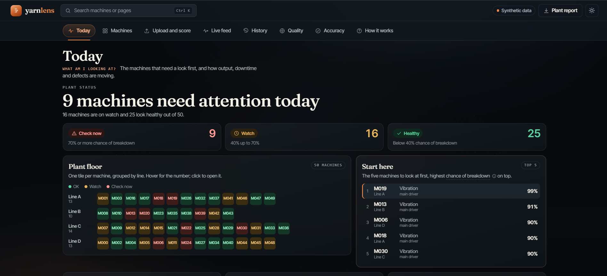
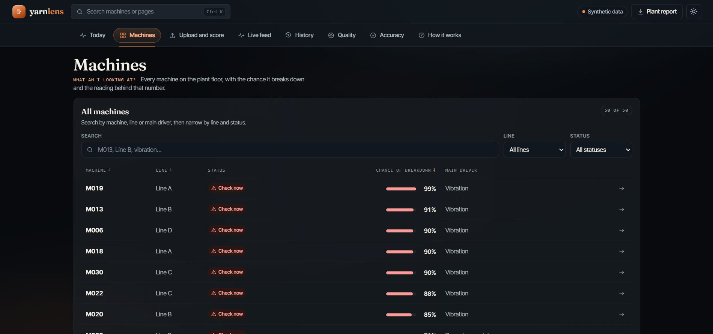
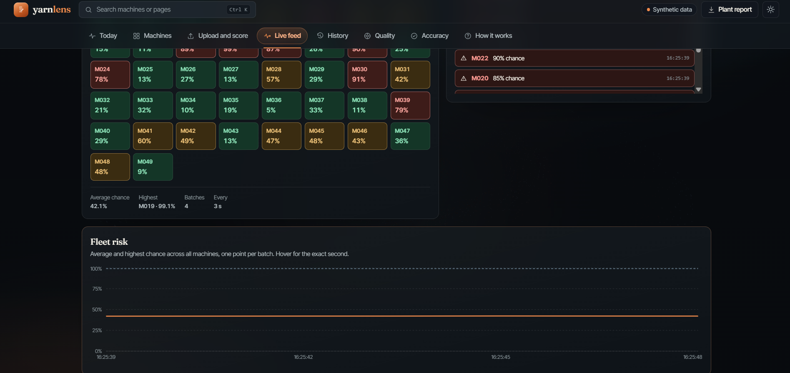
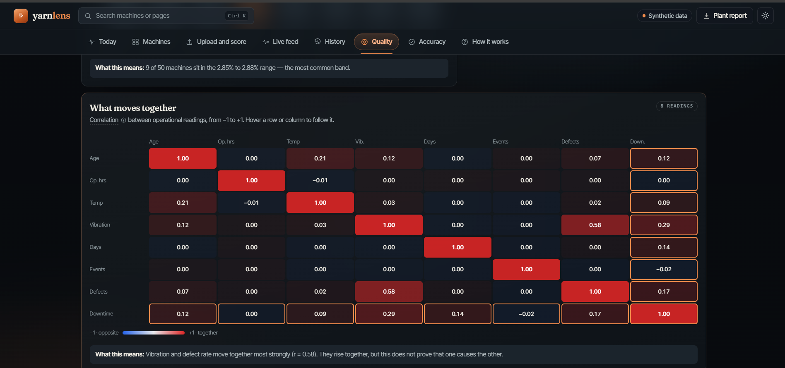
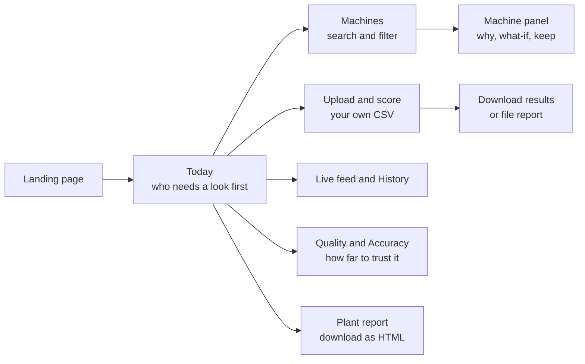

<div align="center">

# Manufacturing Data Analytics: A YARN Approach

### YarnLens: know which machine to check next

A big-data pipeline over **synthetic** factory telemetry (HDFS, YARN, Spark, Hive),
with a web dashboard that turns the results into one ranked list of machines.

[](https://yarnlens.vercel.app)


<br>


</div>

---

## Table of Contents

* [Overview](#overview)
* [Problem Statement and Proposed Solution](#problem-statement-and-proposed-solution)
* [Live Application](#live-application)
* [Screenshots](#screenshots)
* [Core Features](#core-features)
* [Application Workflow](#application-workflow)
* [System Architecture](#system-architecture)
* [Technology Stack](#technology-stack)
* [Machine Learning](#machine-learning)
* [Data Pipeline Results](#data-pipeline-results)
* [Project Structure](#project-structure)
* [Local Setup](#local-setup)
* [Environment Variables](#environment-variables)
* [API Overview](#api-overview)
* [Tests](#tests)
* [Production Deployment](#production-deployment)
* [What This Project Demonstrates](#what-this-project-demonstrates)
* [Future Enhancements](#future-enhancements)
* [Author](#author)

## Overview

Factories record machine readings every minute: temperature, vibration, hours run and maintenance history. This project processes about half a million of those readings on a Hadoop, YARN and Spark cluster, trains models that estimate each machine's chance of breaking down, and shows the answer as a ranked list with one reason per machine.

The dashboard is called **YarnLens**. It runs in any browser, with no login and no server.

> [!NOTE]
> **The data is synthetic.** Every row comes from `data/generate_data.py`. No number in this repository describes a real factory, and nothing here is a benchmark of real-world performance. The cluster is a single Docker engine on one laptop: it demonstrates the architecture, it does not demonstrate multi-server speed-ups.

## Problem Statement and Proposed Solution

**The problem.** Machines in a plant produce a steady stream of readings. The volume is too large for a single spreadsheet or script to handle comfortably, and the raw numbers are not something a maintenance team can act on. Teams need to know one thing: *which machine should I look at first?*

**The solution.** A software-only pipeline in two halves:

1. **A big-data back end.** HDFS stores the readings, YARN shares the cluster's CPU and memory between jobs, Spark cleans the data and trains the models, and Hive answers SQL questions over the same files.
2. **A plain-language dashboard.** YarnLens reads small exported results and shows one ranked list, the reading behind each score, a what-if simulator, and reports that can be downloaded.

## Live Application

**<https://yarnlens.vercel.app>**

The hosted site is static, so everything runs in your browser. A quick way to try it:

1. Open the site and click **Open dashboard**. The **Today** page lists the machines that need a look first.
2. Open **Upload and score**, click **Sample of 50 machines** to download a CSV, then drop it back onto the page to see it scored.
3. Open **Live feed** to watch simulated readings update every three seconds.

## Screenshots

<table>
  <tr>
    <td width="50%" valign="top">
      
      <br><b>Today</b>: which machines need a look first, with a plant-floor tile per machine.
    </td>
    <td width="50%" valign="top">
      
      <br><b>Machines</b>: search, filter and sort all 50 machines; open one for the reason and a what-if.
    </td>
  </tr>
  <tr>
    <td width="50%" valign="top">
      
      <br><b>Upload and score</b>: score your own CSV in the browser; every row shows the readings behind its score.
    </td>
    <td width="50%" valign="top">
      
      <br><b>Live feed</b>: a simulated batch every 3 seconds, clearly labelled as simulated.
    </td>
  </tr>
  <tr>
    <td width="50%" valign="top">
      
      <br><b>History</b>: scored readings kept in this browser, with a per-hour trend.
    </td>
    <td width="50%" valign="top">
      
      <br><b>Quality</b>: defect-rate ranges and a correlation heatmap in plain words.
    </td>
  </tr>
  <tr>
    <td width="50%" valign="top">
      
      <br><b>Accuracy</b>: what the model catches, how many alarms are false, and why.
    </td>
    <td width="50%" valign="top">
      
      <br><b>How it works</b>: the three steps, the cluster used, and what this setup is not.
    </td>
  </tr>
</table>

## Core Features

| Area | What it does |
|---|---|
| **Today** | A generated headline ("N machines need attention today"), Check now / Watch / Healthy counts, a plant-floor tile grid grouped by line, and the top five machines to check first |
| **Machines** | Search by machine, line or main driver, filter by line and status, sort the table; each row opens a side panel |
| **Machine panel** | A plain-language risk sentence, the key readings, "Why this score" contribution bars, what-if sliders, one rule-of-thumb focus suggestion, and Keep as OK / Watch / Check now |
| **Upload and score** | Drop in a CSV of readings. The browser checks the columns, scores every row and ranks the machines. Nothing is uploaded anywhere |
| **File check** | Missing columns by name, skipped rows with the reason, and rows read versus rows scored; three deliberately broken sample files are included for testing |
| **Live feed** | A simulated reading per machine every 3 seconds, scored with the saved model and labelled "Simulated" |
| **History** | Scored readings kept in the browser and charted per hour |
| **Quality** | Defect-rate ranges and a correlation heatmap with a generated "what this means" line |
| **Accuracy** | A plain verdict from the confusion matrix, a model comparison and feature importance |
| **Reports** | A plant report and a per-file upload report, both self-contained HTML built at click time |
| **Polish** | Light and dark theme, `Ctrl + K` search for machines and pages, a Synthetic data badge on every page |
| **Optional API** | FastAPI + PostgreSQL in Docker, serving the three scikit-learn models |

## Application Workflow

How a person uses the dashboard:



How the data gets there:

1. `data/generate_data.py` writes the synthetic readings.
2. `ingestion/upload_to_hdfs.ps1` puts the raw file on HDFS.
3. `spark_jobs/clean.py` cleans it and writes Parquet; `spark_jobs/analytics.py` writes the aggregates.
4. `ml/train.py` trains the models and exports the fitted logistic regression.
5. `hive/create_tables.sql` exposes the Parquet to SQL.
6. `dashboard/scripts/export_dashboard_data.py` turns the small CSV exports into the JSON the dashboard reads.

## System Architecture

```mermaid
flowchart TB
    subgraph CLUSTER["Big-data cluster (Docker, one laptop)"]
        HDFS[("HDFS")] --> SPARK["Spark on YARN"]
        SPARK --> PARQUET["Parquet on HDFS"]
        PARQUET --> HIVE["Hive + PostgreSQL metastore"]
    end
    SPARK -->|"CSV exports"| JSON["11 JSON files"]
    subgraph BROWSER["Browser (static site on Vercel)"]
        APP["YarnLens: React + Vite"]
        LS[("localStorage")]
    end
    JSON --> APP
    APP --- LS
    subgraph API["Optional local API (Docker)"]
        FASTAPI["FastAPI + scikit-learn models"] --> PG[("PostgreSQL")]
    end
    APP -.->|"only if reachable"| FASTAPI
```



**Static mode and live mode.** The hosted site has no backend. At startup the front end asks `GET /api/health` once. If nothing answers, it stays in *static mode*: Upload, Live feed, History and the reports all run in the browser with the exported coefficients, and nothing shows an error. If the local API is running, the app switches to *live mode* and Upload also offers the decision tree and random forest, which the browser cannot run.

**Where each part lives.**

| Part | Runs | Reads or stores |
|---|---|---|
| Big-data cluster | Local Docker only | HDFS, Hive metastore |
| Dashboard | Any browser, hosted on Vercel | The exported JSON; `localStorage` for History and kept what-if conditions |
| Optional API | Local Docker only | Saved joblib models; its own PostgreSQL |

**YARN is the cluster's resource manager.** It is not storage and not a learning algorithm. HDFS stores the data, Spark does the work, MLlib trains the model, and YARN only decides which machine runs each container and how much memory and CPU it gets.

## Technology Stack

| Layer | Component | Version |
|---|---|---|
| Storage | HDFS, 1 NameNode + 2 DataNodes | Hadoop 3.3.6 |
| Resource management | YARN, 1 ResourceManager + 2 NodeManagers | Hadoop 3.3.6 |
| Processing | Spark submitted with `--master yarn` | Spark 3.5.9 (Scala 2.12, Java 11) |
| Machine learning | Spark MLlib (logistic regression, decision tree, random forest) | bundled with Spark 3.5.9 |
| SQL | HiveServer2 + metastore, schema in PostgreSQL | Hive 4.0.0, PostgreSQL 16 |
| Dashboard | React, Vite, TypeScript, Recharts, Three.js (landing wave) | React 18.3, Vite 5, Three.js 0.187.0 |
| Dashboard tests | Vitest | 2.1.9 |
| Optional API | FastAPI, uvicorn, scikit-learn, joblib, pandas, psycopg | FastAPI 0.165.0, scikit-learn 1.9.1 |
| Optional API database | PostgreSQL, separate from the Hive metastore | 17.5 (`postgres:17.5-alpine`) |
| Local analysis | pandas, numpy, matplotlib, seaborn, scikit-learn | see `requirements.txt` |

Container images are pinned in `docker/docker-compose.yml` and `docker/docker-compose.app.yml`; nothing uses `latest`.

## Machine Learning

**The task.** Predict the `downtime` flag of a reading. About 7.5 % of readings are downtime, so the data is heavily imbalanced.

**Features (six).** `machine_age_years`, `operating_hours`, `temperature_c`, `vibration_mm_s`, `days_since_maintenance`, `past_maintenance_events`.

**Method.**
- **Time-based split at `2024-10-01`.** The earlier period trains and the later period tests. A random split would leak, because one-minute readings from the same machine are near-copies of each other.
- **Class weighting.** Each model gives downtime rows the weight neg/pos (12.2488 in the Spark run) and other rows 1.0.
- **Three models.** Logistic regression, decision tree and random forest, in both Spark MLlib and scikit-learn.
- **The shipped model** is the Spark logistic regression. Its intercept, coefficients, means and standard deviations are exported to `dashboard/public/data/model_coefficients.json`, and the browser reproduces it exactly:

```
z = intercept + sum_i coef_i * (x_i - mean_i) / std_i        p = 1 / (1 + exp(-z))
```

The formula was checked against Spark's own probability for a held-out row: `pipeline=0.266533 formula=0.266533 abs_diff=0.000000000`.

**Status rule.** The display rule in `kpis.json` is: **Check now** at 70 % or more, **Watch** from 40 % up to 70 %, **Healthy** below 40 %.

**Leading coefficients** of the Spark logistic regression: `vibration_mm_s` 0.861, `days_since_maintenance` 0.632, `machine_age_years` 0.420, `temperature_c` 0.310.

### Two sets of metrics, never mixed

`dashboard/public/data/model_metrics.json` holds the **Spark MLlib** metrics. `backend/models/metrics_sklearn.json` holds the **scikit-learn** metrics from `ml/export_sklearn_models.py` on its own held-out split. They use different libraries, splitters and class weighting, so they are printed separately and must not be compared as one number.

**Spark MLlib** (`ml/train.py`): 390,587 training rows, 104,413 held-out rows, positive share in training 0.0755.

| Model | Precision | Recall | F1 | ROC-AUC | Accuracy |
|---|---|---|---|---|---|
| Logistic regression | 0.1887 | 0.7283 | 0.2998 | 0.8133 | 0.7429 |
| Decision tree | 0.1817 | 0.6923 | 0.2879 | 0.5336 | 0.7413 |
| Random forest | 0.1822 | 0.7075 | 0.2897 | 0.7992 | 0.7379 |

**scikit-learn** (`ml/export_sklearn_models.py`): 392,536 training rows, 104,941 held-out rows, every model with `class_weight="balanced"`.

| Model | Precision | Recall | F1 | ROC-AUC |
|---|---|---|---|---|
| Logistic regression | 0.1886 | 0.7282 | 0.2996 | 0.8131 |
| Decision tree | 0.1869 | 0.6850 | 0.2937 | 0.7943 |
| Random forest | 0.1826 | 0.7208 | 0.2914 | 0.8044 |

**How to read these.** Accuracy is listed last on purpose: with about 7.5 % downtime, predicting "running" every time already scores about 92 %. The models are tuned to catch downtime (recall about 0.73), and the synthetic classes overlap, so precision is about 0.19: roughly four of five "Check now" flags are false alarms. ROC-AUC near 0.81 shows the ranking signal exists, which is why the dashboard is built to say *what to check first* rather than to raise an alarm.

**The decision-tree ROC-AUC of 0.5336 in the Spark export is a known artefact.** It was scored on hard 0/1 predictions instead of probabilities. The scikit-learn export and the API use `predict_proba`, which gives 0.7943 on the held-out period, and `backend/tests/test_api.py` asserts that the served tree returns probabilities that vary between machines.

## Data Pipeline Results

Everything below was copied from runs of the commands in [Local Setup](#local-setup) on one laptop.

<details>
<summary><b>Cleaning</b> (<code>clean.py</code>)</summary>

<br>

| Step | Rows |
|---|---|
| Read from `/data/raw/manufacturing_data.csv` | 502,500 |
| Exact duplicate rows dropped | 2,500 |
| Rows dropped for null `units_produced` (production cannot be invented) | 5,000 |
| Written to `/data/clean` (read back to confirm) | 495,000 |

`temperature_c` and `vibration_mm_s` are median-imputed (medians 74.49 and 3.088); `defect_rate` is recomputed from `defects / units_produced`.

</details>

<details>
<summary><b>Hive layer</b> (<code>create_tables.sql</code>, <code>queries.sql</code>)</summary>

<br>

Row counts returned by `create_tables.sql`, matching Spark's own counts:

| Table | Rows |
|---|---|
| `manufacturing_clean` | 495,000 |
| `production_by_day` | 348 |
| `downtime_by_machine` | 50 |
| `defect_by_line` | 4 |

Downtime readings rise with time since maintenance (`queries.sql`, query 5):

| Days since maintenance | Readings | Downtime readings (%) |
|---|---|---|
| 0-29 | 82,895 | 3.1956 |
| 30-59 | 82,306 | 4.2682 |
| 60-89 | 82,058 | 5.9312 |
| 90-119 | 82,474 | 7.9516 |
| 120+ | 165,267 | 11.9697 |

Defect rate by line (volume weighted, query 2): Line_D 2.9170 %, Line_C 2.8826 %, Line_B 2.8819 %, Line_A 2.8749 %.

Highest-downtime machines (query 4): M031 13.8277 %, M022 13.7042 %, M005 13.4811 %, M011 13.1321 %, M023 12.7451 %.

</details>

<details>
<summary><b>Maintenance priority list</b> (<code>ml/train.py</code>)</summary>

<br>

Risk alone ranks machines by probability; a slow machine that is down often can cost fewer units than a fast one with a lower probability. The job therefore prices the risk in units and exports `maintenance_priority.csv`:

```
estimated_lost_units_24h = p(downtime) x 1440 minutes x mean units per running minute
```

The production rate is measured per machine from readings where it was **not** down. The 24-hour horizon assumes the near future resembles that machine's own history: an estimate for ordering work, not a forecast. The estimate exists in `machine_risk.json` but is **hidden in the dashboard**.

Top of the list as measured: M013 (Line_B) ~657,019 units at p = 0.9122, M006 (Line_D) ~647,843 at p = 0.8994, M030 (Line_C) ~647,124 at p = 0.8989.

</details>

<details>
<summary><b>What-if simulator</b></summary>

<br>

`ml/train.py` exports the fitted coefficients, intercept and the scaler's mean and standard deviation (`model_parameters.csv`), because the browser must not load a Spark pipeline from HDFS. The React front end evaluates that linear model, so the sliders show the **saved** model's probability. Sliders move days since maintenance, temperature and vibration; machine age, operating hours and maintenance history stay at the selected machine's latest values.

Keeping a what-if reading writes an override to `localStorage`, never to `machine_risk.json`. The row is recomputed from the saved coefficients, flagged as simulated, and can be restored.

</details>

<details>
<summary><b>YARN tuning benchmark</b> (<code>docs/benchmarks.md</code>)</summary>

<br>

The same Spark job (a full scan plus a `groupBy(machine_id, line)` aggregation) was run under five executor configurations and two input sizes on 2 NodeManagers x 2048 MB x 2 vcores. Each configuration was sampled once, and a 5 MB table mostly measures YARN container start-up, so run-to-run variance exceeds the data-size effect and **no strong scaling claim is made**. The full table is in [`docs/benchmarks.md`](docs/benchmarks.md) and the raw runs in [`docs/benchmark_runs.csv`](docs/benchmark_runs.csv).

</details>

<details>
<summary><b>Figures</b> (<code>docs/figures/</code>)</summary>

<br>

Production trend, downtime by machine, defect-rate distribution, correlation heatmap, feature importance and confusion matrix, produced by `visualizations/make_figures.py`.

</details>

## Project Structure

```
data/                      synthetic dataset generator (CSVs are gitignored)
ingestion/                 upload_to_hdfs.ps1: docker cp + hdfs dfs -put
docker/                    Hadoop/Spark/Hive compose file, images, config, start scripts
  docker-compose.app.yml   the optional API + PostgreSQL stack (separate from Hadoop)
spark_jobs/                clean.py, analytics.py, benchmark.py
benchmarks/                PowerShell driver + subset builder for the YARN tuning runs
hive/                      create_tables.sql (external tables), queries.sql (five queries)
ml/                        train.py (Spark MLlib), export_sklearn_models.py (servable models)
visualizations/            make_figures.py: six figures from the exported CSVs
backend/                   FastAPI scoring API, saved joblib models, PostgreSQL schema, tests
  app/                     main.py, schemas.py, model_store.py, simulator.py, db.py, config.py
  models/                  logistic_regression / decision_tree / random_forest .joblib + metrics
  db/init.sql              tables: machines, readings, scores
dashboard/                 React + Vite front end (landing page + eight pages)
  src/pages/               Today, Machines, Upload, Live, History, Quality, Accuracy, HowItWorks, Landing
  src/lib/                 scoring, csv, live simulator, history store, reports
  public/data/             the exported JSON the dashboard reads
  public/samples/          sample_ok.csv + three deliberately broken files for Upload
  scripts/                 export_dashboard_data.py, make_sample_csvs.py
docs/                      benchmarks.md, benchmark_runs.csv, figures/, screenshots/
legacy/streamlit/          previous Streamlit prototype (superseded)
```

See [`dashboard/README.md`](dashboard/README.md) for the pages, design notes and the JSON data contract.

## Local Setup

Pick the path that matches what you want to do. Path A takes about two minutes.

### A. Dashboard only (no Docker)

Needs Node.js 18 or newer. Every page works without a backend.

```powershell
git clone https://github.com/Mohith417/manufacturing-yarn-analytics
cd manufacturing-yarn-analytics\dashboard
npm install
npm run dev        # http://127.0.0.1:5173
```

Other commands: `npm test` (unit tests) and `npm run build` (static build in `dashboard/dist`). The dashboard opens on its landing page at <http://127.0.0.1:5173/#home>; `#today` goes straight to the report.

### B. Optional scoring API (Docker)

One command brings up the API and its own PostgreSQL. This is a different container from the Hive metastore and does not touch the Hadoop stack.

```powershell
Copy-Item .env.example .env     # once; local values only, .env is gitignored
docker compose --env-file .env -f docker/docker-compose.app.yml up --build
```

Then run `npm run dev` in `dashboard/`. The API answers on <http://127.0.0.1:8000/api/health>, and its interactive docs are at <http://127.0.0.1:8000/docs>. Stop the containers and the dashboard returns to static mode without a reload error.

To retrain the scikit-learn models and their metrics:

```powershell
.venv\Scripts\python.exe ml\export_sklearn_models.py
```

### C. Full big-data cluster (Docker)

Needs Docker Desktop with enough memory for seven daemons (see `docker/wslconfig.example`), Python and PowerShell.

**1. Generate the synthetic data** (PowerShell, from the repository root):

```powershell
python -m venv .venv
.venv\Scripts\Activate.ps1
pip install -r requirements.txt
python data\generate_data.py          # writes data\manufacturing_data.csv (gitignored)
```

**2. Start the cluster and upload the raw file:**

```powershell
cd docker
docker compose up -d --build
docker compose ps
cd ..
.\ingestion\upload_to_hdfs.ps1
```

**3. Run the Spark jobs.** These are Linux commands inside the containers. Run them from Git Bash with `export MSYS_NO_PATHCONV=1`, otherwise `/work/...` is rewritten to a Windows path:

```bash
docker exec spark-client spark-submit --master yarn \
  --conf spark.executor.memory=1g --conf spark.executor.cores=1 \
  --conf spark.driver.memory=1g /work/spark_jobs/clean.py

docker exec spark-client spark-submit --master yarn \
  --conf spark.executor.memory=1g --conf spark.executor.cores=1 \
  --conf spark.driver.memory=1g /work/spark_jobs/analytics.py

docker exec spark-client spark-submit --master yarn \
  --conf spark.executor.memory=1g --conf spark.executor.cores=1 \
  --conf spark.driver.memory=1g /work/ml/train.py
```

**4. Run the Hive scripts** (Linux commands):

```bash
docker exec hiveserver2 beeline -u 'jdbc:hive2://localhost:10000/' -f /work/hive/create_tables.sql
docker exec hiveserver2 beeline -u 'jdbc:hive2://localhost:10000/' -f /work/hive/queries.sql
```

**5. Make the figures and export the JSON the dashboard reads** (PowerShell, no cluster needed):

```powershell
.venv\Scripts\Activate.ps1
python visualizations\make_figures.py
.venv\Scripts\python.exe dashboard\scripts\export_dashboard_data.py
```

**YARN tuning benchmark** (PowerShell) writes `docs/benchmark_runs.csv`, summarised in `docs/benchmarks.md`:

```powershell
docker exec spark-client spark-submit --master yarn `
  --conf spark.executor.memory=1g --conf spark.executor.cores=1 `
  /work/benchmarks/prepare_subsets.py

.\benchmarks\run_benchmarks.ps1
```

**Web UIs:** NameNode <http://localhost:9870>, YARN <http://localhost:8088>, HiveServer2 <http://localhost:10002>.

## Environment Variables

**No API key or secret is needed anywhere in this project.** The values below are local development settings only. Copy `.env.example` to `.env` (gitignored) to change them.

| Variable | Default | Used by | Meaning |
|---|---|---|---|
| `POSTGRES_USER` | `yarnlens` | API stack | Database user |
| `POSTGRES_PASSWORD` | `yarnlens` | API stack | Local-only password; never reuse a real one |
| `POSTGRES_DB` | `yarnlens` | API stack | Database name |
| `POSTGRES_PORT` | `5433` | API stack | Port published on `127.0.0.1` |
| `API_PORT` | `8000` | API stack | Port the API is published on |
| `SIMULATED_INTERVAL_SECONDS` | `3` | API | Seconds between simulated batches |
| `HISTORY_RETENTION` | `100000` | API | Maximum stored readings |
| `DATABASE_URL` | set by compose | API | Connection string for the API's PostgreSQL |
| `RISK_RED_AT` / `RISK_AMBER_AT` | `0.7` / `0.4` | API | Status thresholds |
| `VITE_API_URL` | `http://127.0.0.1:8000` | Dashboard (build time) | Where the front end looks for the optional API |

## API Overview

The optional API scores readings with the saved scikit-learn models. It allows cross-origin requests only from `localhost` and `127.0.0.1` on ports 5173 and 8080. Invalid input returns `422`, an unknown model returns `400`, and history endpoints return `503` if the database is down.

| Method | Path | Purpose |
|---|---|---|
| `GET` | `/api/health` | Status, loaded models, database state and the simulation interval |
| `GET` | `/api/models` | The loaded models with their scikit-learn held-out metrics |
| `POST` | `/api/score` | Score 1 to 5,000 readings with one model (default `logistic_regression`) |
| `GET` | `/api/stream` | Server-Sent Events: one batch of simulated, scored readings per interval |
| `GET` | `/api/history` | Stored scored readings; optional `machine_id`, `limit` (1 to 1000, default 200) |
| `GET` | `/api/trends` | Average risk per hour; `hours` from 1 to 168 (default 24) |
| `DELETE` | `/api/history?confirm=clear-all` | Clear stored readings; refuses without the confirm value |

Example request (PowerShell):

```powershell
$body = @{
  model = "random_forest"
  readings = @(@{
    machine_id = "M013"; machine_age_years = 16.6; operating_hours = 23.9
    temperature_c = 74.1; vibration_mm_s = 8.4
    days_since_maintenance = 135; past_maintenance_events = 2
  })
} | ConvertTo-Json -Depth 4

Invoke-RestMethod -Method Post -Uri http://127.0.0.1:8000/api/score `
  -ContentType "application/json" -Body $body
```

The response has the model name, the library (`scikit-learn`), and one result per reading with `machine_id`, `risk` (0 to 1), `status` (`green`, `amber` or `red`) and `top_factors`. Every row the stream produces is flagged `simulated`.

## Tests

```powershell
cd dashboard
npm test            # 24 tests: CSV reader/validator, scoring vs Python, live simulator, history store

cd ..\backend
..\.venv\Scripts\python.exe -m pytest tests -q    # 10 tests
```

The pytest storage test is skipped unless the Postgres container is running; point `DATABASE_URL` at `127.0.0.1:5433` to run it against the compose database. Before each push the front end is also checked with `tsc --noEmit` and `npm run build`.

## Production Deployment

The dashboard is a static site hosted on Vercel at **<https://yarnlens.vercel.app>**.

| Setting | Value |
|---|---|
| Root Directory | `dashboard` |
| Framework preset | Vite |
| Install command | `npm install` |
| Build command | `npm run build` |
| Output directory | `dist` |
| Environment variables | none |

Pushing to `main` triggers a new deployment. The scoring API, its database and the Hadoop cluster run locally only, so the hosted site runs in static mode.

## What This Project Demonstrates

* **Distributed data processing.** 495,000 cleaned readings handled with Spark on a YARN cluster, stored on HDFS, with Hive SQL over the same Parquet files.
* **Leakage-aware modelling.** A time-based split instead of a random one, because one-minute readings from the same machine are near-copies of each other.
* **Honest evaluation.** Class weighting for the rare downtime label, accuracy listed last, false alarms shown on the Accuracy page, and a known ROC-AUC artefact found, explained and fixed in the scikit-learn export.
* **Reproducible setup.** Pinned container images and package versions, no API keys, one command per stage, and automated tests.
* **Product thinking.** One ranked list, one plain-language reason per machine, a what-if simulator, and reports a plant manager can download.
* **Privacy by design.** Upload scoring happens in the browser, so no file ever leaves the visitor's machine.
* **Shipping.** A live, static deployment on Vercel with no server to maintain.

## Future Enhancements

Ideas for next steps. None of these are built yet.

* Tune the alert threshold to cut false alarms while keeping most of the recall.
* Feed the pipeline from a real streaming source instead of the simulated feed.
* Run the cluster on several machines to measure real speed-up.
* Host the scoring API with a managed database, so the decision tree and random forest are available online.
* Retrain on labelled readings uploaded by the user.
* Add per-machine quality and defect views.

## Author

Built by [Mohith417](https://github.com/Mohith417).
