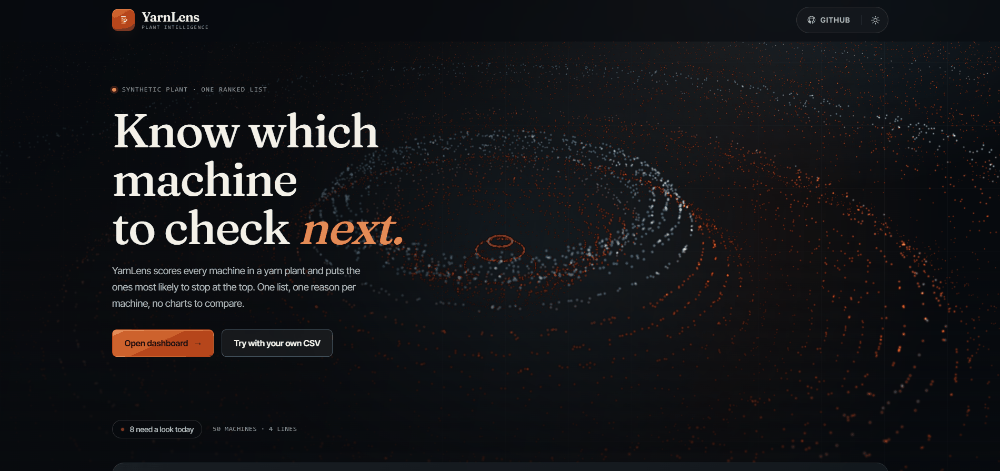
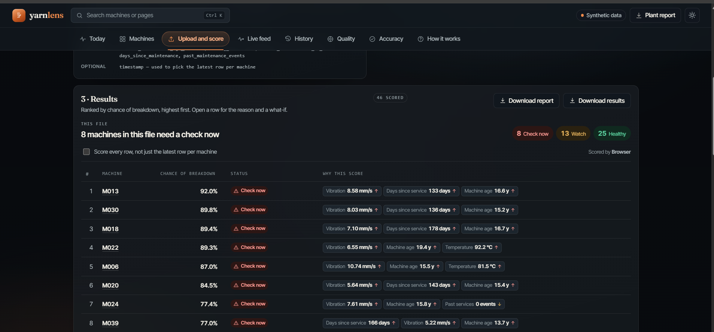
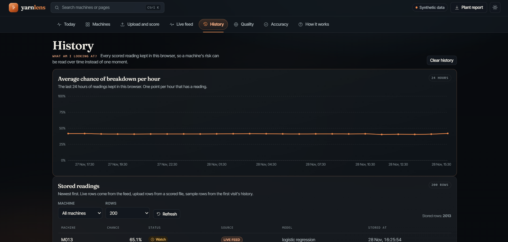
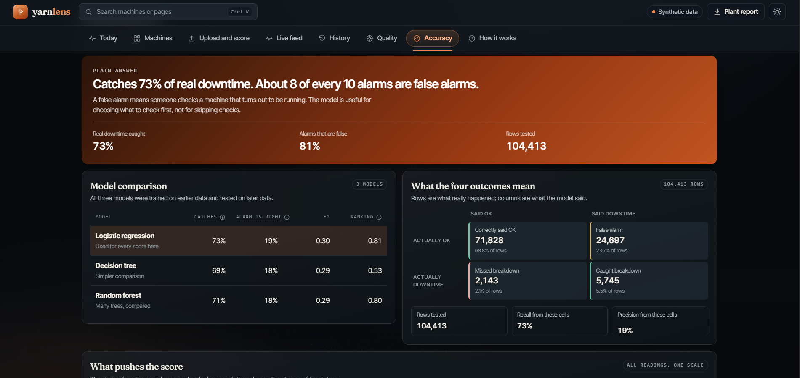
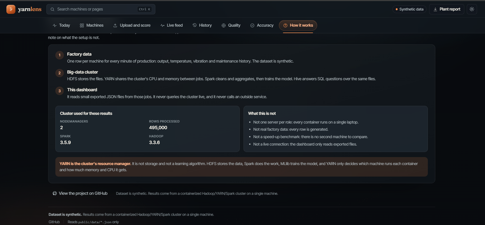
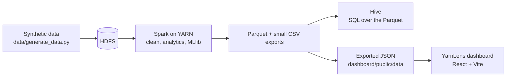

<div align="center">

# Manufacturing Data Analytics: A YARN Approach

### YarnLens — know which machine to check next

A big-data pipeline over **synthetic** factory telemetry (HDFS, YARN, Spark, Hive),
with a web dashboard that turns the results into one ranked list of machines.

[](https://yarnlens.vercel.app)


[**Live demo**](https://yarnlens.vercel.app) &nbsp;·&nbsp; [**Run it locally**](#quick-start) &nbsp;·&nbsp; [**Screenshots**](#screenshots) &nbsp;·&nbsp; [**Results**](#results)

<br>



</div>

---

## Contents

1. [What it is](#what-it-is)
2. [Highlights](#highlights)
3. [Screenshots](#screenshots)
4. [How it works](#how-it-works)
5. [Tech stack](#tech-stack)
6. [Quick start](#quick-start)
7. [Results](#results)
8. [Tests](#tests)
9. [Repository layout](#repository-layout)
10. [Design decisions](#design-decisions-worth-defending)
11. [Limitations](#limitations)
12. [Deployment](#deployment)
13. [Author](#author)

## What it is

Factories record machine readings every minute: temperature, vibration, hours run and
maintenance history. This project processes half a million of those readings on a
Hadoop/YARN/Spark cluster, trains models that estimate each machine's chance of
breaking down, and shows the answer as a ranked list with one reason per machine.

The dashboard is called **YarnLens**. It runs in any browser, with no login and no server.

> [!NOTE]
> **The data is synthetic.** Every row comes from `data/generate_data.py`. No number in
> this repository describes a real factory, and nothing here is a benchmark of real-world
> performance. The cluster is a single Docker engine on one laptop: it demonstrates the
> architecture, it does not demonstrate multi-server speed-ups.

## Highlights

| What | Details |
|---|---|
| **Big-data pipeline** | Synthetic data → HDFS → Spark on YARN → Hive, all in Docker (HDFS 1 NameNode + 2 DataNodes; YARN 1 ResourceManager + 2 NodeManagers) |
| **Cleaning and analytics** | Spark jobs for schema checks, duplicates, missing values, eight aggregates and a correlation matrix |
| **Models** | Spark MLlib logistic regression, decision tree and random forest, trained with a time-based split and class weighting |
| **Eight dashboard pages** | Today, Machines, Upload and score, Live feed, History, Quality, Accuracy, How it works (plus a landing page) |
| **Upload and score** | Drop in a CSV of readings; the browser validates and scores it. Nothing is uploaded anywhere |
| **Simulated live feed** | A new simulated reading per machine every 3 seconds, scored in the browser and labelled "Simulated" |
| **History** | Scored readings kept in the browser, charted per hour |
| **What-if simulator** | Move days since maintenance, temperature and vibration and watch the chance of breakdown change |
| **Two downloadable HTML reports** | A plant report and a per-file upload report, built at click time |
| **Light and dark theme** | Plus a `Ctrl + K` search for machines and pages |
| **Optional scoring API** | FastAPI + PostgreSQL in Docker, serving the three scikit-learn models |

## Screenshots

<table>
  <tr>
    <td width="50%" valign="top">
      
      <br><b>Today</b> — which machines need a look first, with a plant-floor tile per machine.
    </td>
    <td width="50%" valign="top">
      
      <br><b>Machines</b> — search, filter and sort all 50 machines; open one for the reason and a what-if.
    </td>
  </tr>
  <tr>
    <td width="50%" valign="top">
      
      <br><b>Upload and score</b> — score your own CSV in the browser; every row shows the readings behind its score.
    </td>
    <td width="50%" valign="top">
      
      <br><b>Live feed</b> — a simulated batch every 3 seconds, clearly labelled as simulated.
    </td>
  </tr>
  <tr>
    <td width="50%" valign="top">
      
      <br><b>History</b> — scored readings kept in this browser, with a per-hour trend.
    </td>
    <td width="50%" valign="top">
      
      <br><b>Quality</b> — defect-rate ranges and a correlation heatmap in plain words.
    </td>
  </tr>
  <tr>
    <td width="50%" valign="top">
      
      <br><b>Accuracy</b> — what the model catches, how many alarms are false, and why.
    </td>
    <td width="50%" valign="top">
      
      <br><b>How it works</b> — the three steps, the cluster used, and what this setup is not.
    </td>
  </tr>
</table>

## How it works



1. **Factory data.** One row per machine per minute: output, temperature, vibration and maintenance history. The dataset is synthetic.
2. **Big-data cluster.** HDFS stores the files. YARN shares the cluster's CPU and memory between jobs. Spark cleans and aggregates, then trains the model. Hive answers SQL questions over the same files.
3. **This dashboard.** It reads small exported JSON files from those jobs. It never queries the cluster live and never calls an outside service.

**YARN is the cluster's resource manager.** It is not storage and not a learning algorithm. HDFS stores the data, Spark does the work, MLlib trains the model, and YARN only decides which machine runs each container and how much memory and CPU it gets.

The model that runs in the browser is the exported logistic regression:

```
z = intercept + sum_i coef_i * (x_i - mean_i) / std_i        p = 1 / (1 + exp(-z))
```

The formula was checked against Spark's own probability for a held-out row:
`pipeline=0.266533 formula=0.266533 abs_diff=0.000000000`.

## Tech stack

| Layer | Component | Version |
|---|---|---|
| Storage | HDFS, 1 NameNode + 2 DataNodes | Hadoop 3.3.6 |
| Resource management | YARN, 1 ResourceManager + 2 NodeManagers | Hadoop 3.3.6 |
| Processing | Spark submitted with `--master yarn` | Spark 3.5.9 (Scala 2.12, Java 11) |
| Machine learning | Spark MLlib (logistic regression, decision tree, random forest) | bundled with Spark 3.5.9 |
| SQL | HiveServer2 + metastore, schema in PostgreSQL | Hive 4.0.0, PostgreSQL 16 |
| Dashboard | React, Vite, TypeScript, Recharts, Three.js (landing wave) | React 18.3, Vite 5, Three.js 0.187.0 |
| Dashboard tests | Vitest | 2.1.9 |
| Optional API | FastAPI, uvicorn, scikit-learn, joblib, pandas, psycopg | FastAPI 0.165.0, scikit-learn 1.9.1 |
| Optional API database | PostgreSQL (separate from the Hive metastore) | 17.5 (`postgres:17.5-alpine`) |
| Local analysis | pandas, numpy, matplotlib, seaborn, scikit-learn | see `requirements.txt` |

Container images are pinned in `docker/docker-compose.yml` and `docker/docker-compose.app.yml`; nothing uses `latest`.
**No API key or secret is needed anywhere in this project.**

## Quick start

Pick the path that matches what you want to do. Path A takes about two minutes.

### A. Dashboard only (no Docker)

Needs Node.js 18 or newer. Every page works without a backend.

```powershell
git clone https://github.com/Mohith417/manufacturing-yarn-analytics
cd manufacturing-yarn-analytics\dashboard
npm install
npm run dev        # http://127.0.0.1:5173
```

Other commands: `npm test` (unit tests), `npm run build` (static build in `dashboard/dist`).

Without the API, Upload scores in the browser, Live feed drifts and scores a simulated batch every
three seconds, and History keeps those readings in this browser's `localStorage`.

### B. Optional scoring API (Docker)

One command brings up the API and its own PostgreSQL. This is a different container from the Hive
metastore and does not touch the Hadoop stack.

```powershell
Copy-Item .env.example .env     # once; local values only, .env is gitignored
docker compose --env-file .env -f docker/docker-compose.app.yml up --build
```

Then run `npm run dev` in `dashboard/`. `GET /api/health` answers on
<http://127.0.0.1:8000/api/health>; the front end probes it once at startup. With the API up, Upload
also offers the decision tree and random forest (which the browser cannot run), and per-machine history
is available from `GET /api/history`. Stop the containers and the app returns to static mode without a
reload error.

To retrain the scikit-learn models and their metrics:

```powershell
.venv\Scripts\python.exe ml\export_sklearn_models.py
```

### C. Full big-data cluster (Docker)

Needs Docker Desktop with enough memory for seven daemons (see `docker/wslconfig.example`), Python and PowerShell.

**1. Generate the synthetic data** (PowerShell, from the repository root):

```powershell
python -m venv .venv
.venv\Scripts\Activate.ps1
pip install -r requirements.txt
python data\generate_data.py          # writes data\manufacturing_data.csv (gitignored)
```

**2. Start the cluster and upload the raw file:**

```powershell
cd docker
docker compose up -d --build
docker compose ps
cd ..
.\ingestion\upload_to_hdfs.ps1
```

**3. Run the Spark jobs.** These are Linux commands inside the containers. Run them from Git Bash with
`export MSYS_NO_PATHCONV=1`, otherwise `/work/...` is rewritten to a Windows path:

```bash
docker exec spark-client spark-submit --master yarn \
  --conf spark.executor.memory=1g --conf spark.executor.cores=1 \
  --conf spark.driver.memory=1g /work/spark_jobs/clean.py

docker exec spark-client spark-submit --master yarn \
  --conf spark.executor.memory=1g --conf spark.executor.cores=1 \
  --conf spark.driver.memory=1g /work/spark_jobs/analytics.py

docker exec spark-client spark-submit --master yarn \
  --conf spark.executor.memory=1g --conf spark.executor.cores=1 \
  --conf spark.driver.memory=1g /work/ml/train.py
```

**4. Run the Hive scripts** (Linux commands):

```bash
docker exec hiveserver2 beeline -u 'jdbc:hive2://localhost:10000/' -f /work/hive/create_tables.sql
docker exec hiveserver2 beeline -u 'jdbc:hive2://localhost:10000/' -f /work/hive/queries.sql
```

**5. Make the figures and export the JSON the dashboard reads** (PowerShell, no cluster needed):

```powershell
.venv\Scripts\Activate.ps1
python visualizations\make_figures.py
.venv\Scripts\python.exe dashboard\scripts\export_dashboard_data.py
```

**YARN tuning benchmark** (PowerShell) writes `docs/benchmark_runs.csv`, summarised in `docs/benchmarks.md`:

```powershell
docker exec spark-client spark-submit --master yarn `
  --conf spark.executor.memory=1g --conf spark.executor.cores=1 `
  /work/benchmarks/prepare_subsets.py

.\benchmarks\run_benchmarks.ps1
```

**Web UIs:** NameNode <http://localhost:9870>, YARN <http://localhost:8088>, HiveServer2 <http://localhost:10002>.
The dashboard opens on its landing page at <http://127.0.0.1:5173/#home>; `#today` goes straight to the report.

## Results

Everything below was copied from runs of the commands above on one laptop. The dataset is synthetic.

### Two sets of metrics, never mixed

`dashboard/public/data/model_metrics.json` holds the **Spark MLlib** metrics of the pipeline run.
`backend/models/metrics_sklearn.json` holds the **scikit-learn** metrics of `ml/export_sklearn_models.py`
on its own held-out split. They use different libraries, splitters and class weighting, so they are printed
separately and must not be compared as one number.

**Spark MLlib** (`ml/train.py`) — time-based split at `2024-10-01`: 390,587 training rows, 104,413 held-out rows,
positive (downtime) share in training 0.0755, positive-class weight 12.2488.

| Model | Precision | Recall | F1 | ROC-AUC | Accuracy |
|---|---|---|---|---|---|
| Logistic regression | 0.1887 | 0.7283 | 0.2998 | 0.8133 | 0.7429 |
| Decision tree | 0.1817 | 0.6923 | 0.2879 | 0.5336 | 0.7413 |
| Random forest | 0.1822 | 0.7075 | 0.2897 | 0.7992 | 0.7379 |

**scikit-learn** (`ml/export_sklearn_models.py`) — time split at `2024-10-01`: 392,536 training rows,
104,941 held-out rows, every model with `class_weight="balanced"`.

| Model | Precision | Recall | F1 | ROC-AUC |
|---|---|---|---|---|
| Logistic regression | 0.1886 | 0.7282 | 0.2996 | 0.8131 |
| Decision tree | 0.1869 | 0.6850 | 0.2937 | 0.7943 |
| Random forest | 0.1826 | 0.7208 | 0.2914 | 0.8044 |

**How to read these.** Accuracy is listed last on purpose: with about 7.5 % downtime, predicting "running"
every time already scores about 92 %. Precision is low on purpose: the models are tuned to catch downtime
(recall about 0.73), and the synthetic classes overlap, so roughly four of five "Check now" flags are false
alarms. ROC-AUC near 0.81 shows the ranking signal exists; the 0.5 threshold does not turn it into a usable
alarm, which a follow-up would address with threshold tuning, more features or resampling.

**The decision-tree ROC-AUC of 0.5336 in the Spark export is a known artefact.** It was scored on hard 0/1
predictions instead of probabilities. The scikit-learn export and the API use `predict_proba`, which gives
0.7943 on the held-out period, and `backend/tests/test_api.py` asserts that the served tree returns
probabilities that vary between machines.

Leading coefficients of the Spark logistic regression: `vibration_mm_s` 0.861, `days_since_maintenance` 0.632,
`machine_age_years` 0.420, `temperature_c` 0.310.

<details>
<summary><b>Cleaning</b> (<code>clean.py</code>)</summary>

<br>

| Step | Rows |
|---|---|
| Read from `/data/raw/manufacturing_data.csv` | 502,500 |
| Exact duplicate rows dropped | 2,500 |
| Rows dropped for null `units_produced` (production cannot be invented) | 5,000 |
| Written to `/data/clean` (read back to confirm) | 495,000 |

`temperature_c` and `vibration_mm_s` are median-imputed (medians 74.49 and 3.088); `defect_rate` is
recomputed from `defects / units_produced`.

</details>

<details>
<summary><b>Hive layer</b> (<code>create_tables.sql</code>, <code>queries.sql</code>)</summary>

<br>

Row counts returned by `create_tables.sql`, matching Spark's own counts:

| Table | Rows |
|---|---|
| `manufacturing_clean` | 495,000 |
| `production_by_day` | 348 |
| `downtime_by_machine` | 50 |
| `defect_by_line` | 4 |

Downtime readings rise with time since maintenance (`queries.sql`, query 5):

| Days since maintenance | Readings | Downtime readings (%) |
|---|---|---|
| 0-29 | 82,895 | 3.1956 |
| 30-59 | 82,306 | 4.2682 |
| 60-89 | 82,058 | 5.9312 |
| 90-119 | 82,474 | 7.9516 |
| 120+ | 165,267 | 11.9697 |

Defect rate by line (volume weighted, query 2): Line_D 2.9170 %, Line_C 2.8826 %, Line_B 2.8819 %, Line_A 2.8749 %.

Highest-downtime machines (query 4): M031 13.8277 %, M022 13.7042 %, M005 13.4811 %, M011 13.1321 %, M023 12.7451 %.

</details>

<details>
<summary><b>Maintenance priority list</b> (<code>ml/train.py</code>)</summary>

<br>

Risk alone ranks machines by probability; a slow machine that is down often can cost fewer units than a fast
one with a lower probability. The job therefore prices the risk in units and exports `maintenance_priority.csv`:

```
estimated_lost_units_24h = p(downtime) x 1440 minutes x mean units per running minute
```

The production rate is measured per machine from readings where it was **not** down. The 24-hour horizon
assumes the near future resembles that machine's own history: an estimate for ordering work, not a forecast.
The estimate exists in `machine_risk.json` but is **hidden in the dashboard**.

Top of the list as measured: M013 (Line_B) ~657,019 units at p = 0.9122, M006 (Line_D) ~647,843 at
p = 0.8994, M030 (Line_C) ~647,124 at p = 0.8989.

</details>

<details>
<summary><b>What-if simulator</b> (how the browser reproduces the model)</summary>

<br>

`ml/train.py` exports the fitted logistic-regression coefficients, intercept and the scaler's mean/std
(`model_parameters.csv`), because the browser must not load a Spark pipeline from HDFS. The exporter copies
them into `dashboard/public/data/model_coefficients.json`, and the React front end evaluates that linear model
in the browser, so the sliders show the **saved** model's probability. Sliders move days since maintenance,
temperature and vibration; machine age, operating hours and maintenance history stay at the selected
machine's latest values.

Keeping a what-if reading writes an override to `localStorage`, never to `machine_risk.json`. The row is
recomputed from the saved coefficients, flagged as simulated, and can be restored.

</details>

<details>
<summary><b>YARN tuning benchmark</b> (<code>docs/benchmarks.md</code>)</summary>

<br>

The same Spark job (a full scan plus a `groupBy(machine_id, line)` aggregation) was run under five executor
configurations and two input sizes on 2 NodeManagers x 2048 MB x 2 vcores. Each configuration was sampled
once, and a 5 MB table mostly measures YARN container start-up, so run-to-run variance exceeds the
data-size effect. **No strong scaling claim is made.** The full table is in
[`docs/benchmarks.md`](docs/benchmarks.md) and the raw runs in [`docs/benchmark_runs.csv`](docs/benchmark_runs.csv).

</details>

<details>
<summary><b>Figures</b> (<code>docs/figures/</code>)</summary>

<br>

Production trend, downtime by machine, defect-rate distribution, correlation heatmap, feature importance
and confusion matrix, produced by `visualizations/make_figures.py`.

</details>

## Tests

```powershell
cd dashboard
npm test            # 24 tests: CSV reader/validator, scoring vs Python, live simulator, history store

cd ..\backend
..\.venv\Scripts\python.exe -m pytest tests -q    # 10 tests
```

The pytest storage test is skipped unless the Postgres container is running; point `DATABASE_URL` at
`127.0.0.1:5433` to run it against the compose database. Before each push the front end is also checked with
`tsc --noEmit` and `npm run build`.

## Repository layout

```
data/                      synthetic dataset generator (CSVs are gitignored)
ingestion/                 upload_to_hdfs.ps1 - docker cp + hdfs dfs -put
docker/                    Hadoop/Spark/Hive compose file, images, config, start scripts
  docker-compose.app.yml   the optional API + PostgreSQL stack (separate from Hadoop)
spark_jobs/                clean.py, analytics.py, benchmark.py
benchmarks/                PowerShell driver + subset builder for the YARN tuning runs
hive/                      create_tables.sql (external tables), queries.sql (five queries)
ml/                        train.py (Spark MLlib), export_sklearn_models.py (servable models)
visualizations/            make_figures.py - six figures from the exported CSVs
backend/                   FastAPI scoring API, saved joblib models, PostgreSQL schema, tests
dashboard/                 React + Vite front end (landing page + eight pages)
  public/data/             the exported JSON the dashboard reads
  public/samples/          sample_ok.csv + three deliberately broken files for Upload
  scripts/                 export_dashboard_data.py, make_sample_csvs.py
docs/                      benchmarks.md, benchmark_runs.csv, figures/, screenshots/
legacy/streamlit/          previous Streamlit prototype (superseded)
```

The Upload page ships with a working sample plus three deliberately broken files (`bad_missing_column.csv`,
`bad_empty_cells.csv`, `bad_text_values.csv`) so the file-check report can be tested without inventing data.
See [`dashboard/README.md`](dashboard/README.md) for the pages, design notes and the JSON data contract.

## Design decisions worth defending

- **Time-based split, not random.** Readings are one-minute samples from 50 interleaved machines; a random split would score the model on rows that are near-copies of its training rows.
- **Drop, do not impute, unknown production.** Imputing `units_produced` would invent output; temperature and vibration are imputed because they are sensor readings and their median is a defensible stand-in.
- **Hive tables are EXTERNAL.** Hive reads the Parquet Spark already wrote; dropping a table never deletes data, and nothing is duplicated.
- **Dashboard reads files, not the cluster.** The presentation layer keeps working with the cluster stopped, which is what makes it demo-able.
- **Benchmarks state their limits.** One sample per configuration; the fastest configuration there is not a general recommendation.
- **No invented numbers anywhere.** A missing export writes no JSON, so the UI shows "Awaiting data export" instead of a fake value.

## Limitations

- The dataset is synthetic; the live feed is a simulation, not real streaming, and is labelled "Simulated" wherever it appears.
- Uploads are scored, never trained on. The model in the browser is fixed at the exported coefficients.
- Precision is about 0.19 by design (recall about 0.73): roughly four of five "Check now" flags are false alarms. The Accuracy page shows this instead of hiding it.
- The model uses six numeric readings only: no text, images or vibration waveforms.
- The Hadoop cluster is a single Docker engine on one machine, so it demonstrates the architecture rather than multi-server speed-up.
- Benchmark results are single-laptop, shared with several daemons; no scaling claim is made.
- The optional API and its database run locally only. The hosted site has no backend.
- Kept what-if conditions, History and the last-upload summary live in the visitor's own browser and are not shared or stored on a server.
- The Quality page is built from the exported aggregates and does not react to per-machine changes.
- The estimated-lost-units column exists in the export but is hidden in the UI.

## Deployment

The dashboard is a static site hosted on Vercel at **<https://yarnlens.vercel.app>**.

| Setting | Value |
|---|---|
| Root Directory | `dashboard` |
| Framework preset | Vite |
| Build command | `npm run build` |
| Output directory | `dist` |
| Environment variables | none |

The scoring API, its database and the Hadoop cluster run locally only.

## Author

Built by [Mohith417](https://github.com/Mohith417).
